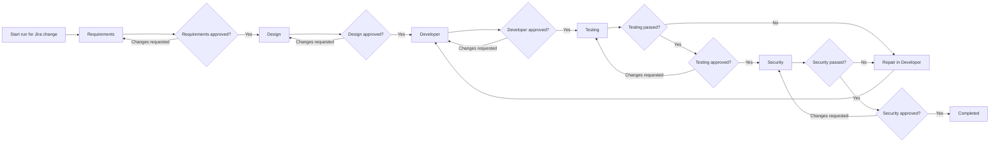

# How the ADLC Orchestrator Works

This guide explains the project in simple language. It is about **how work moves through the system**, not about the internal details of one programming language.

## What is this project?

ADLC Orchestrator is a workflow for safely moving a change request through five stages:

```text
Requirements -> Design -> Development -> Testing -> Security
```

At the end of each stage, a person must approve or reject the result. This is like a document moving through an office:

1. One team prepares the document.
2. A manager reviews it.
3. The manager approves it or sends it back for changes.
4. The approved document moves to the next office.

The project records the entire journey so it can be paused, resumed, or checked later.

## The main example

Imagine a change request called `VISTA-123`:

> “Add password reset for customer accounts.”

The system processes it like this:

| Stage | Example work | Example result |
|---|---|---|
| Requirements | Read the change and identify acceptance criteria | Stories and requirements JSON |
| Design | Decide how password reset should work | Architecture and design contract |
| Developer | Create the branch and implement the feature | Code and a pull request |
| Testing | Map and execute tests | Test report and coverage |
| Security | Check for dangerous issues | SARIF and security summary |

## The overall flow



## Major components

### 1. LangGraph workflow

**Files:** `src/graph.py`, `src/routing.py`, `src/gates.py`

LangGraph is the traffic controller.

It decides:

- Which stage runs next
- Whether the run must pause
- Whether to rerun a stage
- Whether to return to Developer
- Whether to complete or halt

A **gate** is a stopping point. For example, after Requirements, LangGraph waits until somebody approves or rejects it.

### 2. Run state

**File:** `src/state.py`

The run state is a shared information folder passed between stages.

It contains:

- `change_id`: for example, `VISTA-123`
- `stage`: the stage that last ran
- `status`: running, waiting for a gate, completed, or halted
- `gate_decisions`: approved or changes requested at each gate
- `outputs`: files produced by each stage
- `feedback`: comments that tell an agent what to improve
- `loop_counts`: how many testing/security repair loops occurred
- `credit_ledger`: usage information
- `evidence_ids`: identifiers for audit evidence

Think of the state as a checklist attached to the Jira ticket.

### 3. Stage nodes

**Directory:** `src/nodes/`

Every stage uses the same general `StageSpec` wrapper.

Before an agent runs, the wrapper checks:

1. Was the previous stage approved?
2. Is enough AI credit available?
3. Is the context safe?
4. Does this stage have allowed paths and commands?

It then:

1. Builds context for the agent
2. Runs the agent
3. Screens the returned result
4. Checks required files
5. Records evidence
6. Either proceeds, repairs, reruns, or halts

The stage wrapper is in `src/nodes/stage_wrapper.py`.

Stage definitions are in:

- `src/nodes/requirements_node.py`
- `src/nodes/design_node.py`
- `src/nodes/developer_node.py`
- `src/nodes/testing_node.py`
- `src/nodes/security_node.py`

### 4. Tool integrations

**Directory:** `src/tools/`

Tools perform external or supporting work.

| Tool | Purpose | Example |
|---|---|---|
| Copilot CLI | Runs an AI agent for a stage | Generate requirements |
| Jira | Read ticket status, comment, and request approval | “Requirements are ready for approval” |
| GitHub | Create branches and pull requests | Create `adlc/VISTA-123` |
| Context Builder | Combine earlier outputs and reviewer feedback | Show requirements to the design agent |
| Policy | Block unsafe prompts or permissions | Do not allow file deletion |
| Budget | Check AI credit headroom and record usage | Stop if credit is too low |
| Evidence | Record stage completion and traceability | Create evidence ID `EV-3` |
| Graph Retriever | Retrieve knowledge for context | Find related architecture documents |

Some integrations are real, while several are currently stubs used for testing and demonstration.

### 5. Human approval gates

**File:** `src/gates.py`

After every stage, the system creates an approval request in Jira and pauses.

There are two possible decisions:

- `approved`: move to the next stage
- `changes_requested`: rerun the current stage with comments

For example:

```json
{
  "change_id": "VISTA-123",
  "stage": "requirements",
  "decision": "changes_requested",
  "comments": "Add a password-reset expiration time"
}
```

The requirements stage reruns and receives that comment in the `feedback` field.

### 6. FastAPI service

**File:** `src/webhook.py`

FastAPI provides two HTTP endpoints:

| Endpoint | Purpose |
|---|---|
| `POST /runs` | Start a new workflow for a change request |
| `POST /webhooks/jira` | Receive an approval decision from Jira |

The webhook includes an HMAC signature so the service can reject unsigned or modified requests.

### 7. Checkpointing

**File:** `src/checkpointing.py`

A checkpoint is a saved copy of the workflow state.

- **PostgreSQL:** durable; the workflow survives server restarts
- **In-memory:** temporary; state disappears when the process stops

Checkpointing is important because approval gates may wait for hours or days.

### 8. Configuration

**Files:** `config/settings.yaml`, `config/gate_policy.yaml`

`settings.yaml` controls:

- The repair-loop limit
- Credit headroom
- Jira settings
- GitHub settings
- Copilot CLI settings
- Environment-variable names for secrets

`gate_policy.yaml` controls whether each gate is turned on:

```yaml
gates:
  requirements: true
  design: true
  developer: true
  testing: true
  security: true
```

## How a complete run works

### Step 1: Start

A caller sends:

```json
{
  "change_id": "VISTA-123"
}
```

The system creates a new state using `new_run_state()`.

### Step 2: Run Requirements

The requirements agent is given:

- The change ID
- Stage instructions
- Required skill
- Available reviewer feedback

Its result should contain:

- `stories.md`
- `requirements.json`

The run pauses at the requirements gate.

### Step 3: Approve Requirements

Jira or another approved system sends:

```json
{
  "change_id": "VISTA-123",
  "stage": "requirements",
  "decision": "approved",
  "comments": ""
}
```

The system records the approval and starts Design.

### Step 4: Continue through all stages

The same pattern repeats:

```text
Stage -> Check results -> Ask for approval -> Receive decision -> Continue or rerun
```

### Step 5: Finish

After the Security gate is approved, the state becomes:

```text
status = completed
```

If no approval is received, the run remains paused and may resume later.

## Repair and failure behavior

There are two types of failure:

### Stage exit failure

Requirements and design have no automatic repair route in this design. If required outputs are missing or the stage result is not usable, the run stops.

### Testing or security failure

Testing and security are repairable. They can send the run back to Developer.

Example:

```text
Testing finds three failing acceptance tests
  -> Testing result is fail
  -> Run returns to Developer
  -> Developer receives the findings
  -> Developer reruns and updates the pull request
  -> Testing runs again
```

The repair count is stored under `loop_counts`.

The default cap is `3`. Once the limit is exceeded, the run stops with:

```text
repair-loop cap reached
```

## Test data

The repository contains automated test fixtures using synthetic change ID `VISTA-1`.

These are code-level test inputs, not live company data:

- The happy-path test approves all five stages.
- The change-request test reruns Requirements.
- The repair test makes Testing fail once, then pass.
- The repair-cap test makes Testing fail repeatedly.

The test suite uses:

- Stub tools
- Stub Copilot responses
- `MemorySaver` instead of PostgreSQL

No Jira issue, GitHub repository, or production account is changed by the tests.

The earlier local demo used `VISTA-DEMO`. Its server state is temporary and held only in memory. Context-pack JSON files may appear under `/tmp/adlc-packs` on macOS/Linux during testing or demo use.

## What is real and what is simulated?

| Component | Real or stub? |
|---|---|
| LangGraph state and routing | Implemented |
| Approval interrupt and resume | Implemented |
| FastAPI endpoints | Implemented |
| PostgreSQL checkpoints | Implemented |
| Jira REST client | Partially implemented |
| GitHub branch and pull request client | Implemented |
| Copilot CLI wrapper | Implemented, contract needs confirmation |
| Context Builder | Stub |
| Policy engine | Stub |
| Budget engine | Stub |
| Evidence tracker | Stub |
| Graph Retriever | Stub |

A stub is a stand-in that behaves like the real component. It lets developers test flow and routing without external services.

## Common example scenarios

### Everything succeeds

```text
Start -> Requirements approved -> Design approved -> Developer approved
-> Testing passed and approved -> Security passed and approved -> Completed
```

### A requirement needs correction

```text
Requirements approved? No, changes requested
-> Requirements reruns
-> Reviewer approves
-> Design starts
```

### Testing finds a bug

```text
Testing fails
-> Developer reruns
-> Developer approval gate
-> Testing reruns
-> Testing passes
-> Security starts
```

### The repair loop keeps failing

```text
Testing fails repeatedly
-> Repair-loop count exceeds 3
-> Run is halted
-> Jira comment explains the halt
```

## File map

```text
config/
  gate_policy.yaml       Approval gate switches
  settings.yaml          Jira, GitHub, Copilot, and runtime settings

src/
  main.py                Application startup
  graph.py               LangGraph workflow structure
  state.py               Run-state fields
  routing.py             Stage success/failure routing
  gates.py               Approval request and resume behavior
  webhook.py             HTTP API and webhook endpoints
  checkpointing.py       PostgreSQL or memory checkpoints
  config.py              YAML configuration loader

  nodes/
    stage_wrapper.py     Shared stage behavior
    requirements_node.py Requirements stage definition
    design_node.py       Design stage definition
    developer_node.py    Developer stage definition
    testing_node.py      Testing stage definition
    security_node.py     Security stage definition

  tools/
    copilot_cli_tool.py  Agent runner
    jira_tool.py         Jira integration
    codebase_tool.py     GitHub integration
    context_builder_tool.py
    policy_tool.py
    budget_tool.py
    evidence_tool.py
    graph_retriever.py

tests/
  test_flow.py           End-to-end workflow tests

README.md                Setup and run instructions
HOW_IT_WORKS.md          This simple component and flow guide
```

## In one sentence

The ADLC Orchestrator is a pauseable, auditable assembly line: each stage performs work, records evidence, asks for human approval, and either moves forward, reruns, repairs code, or stops safely.
